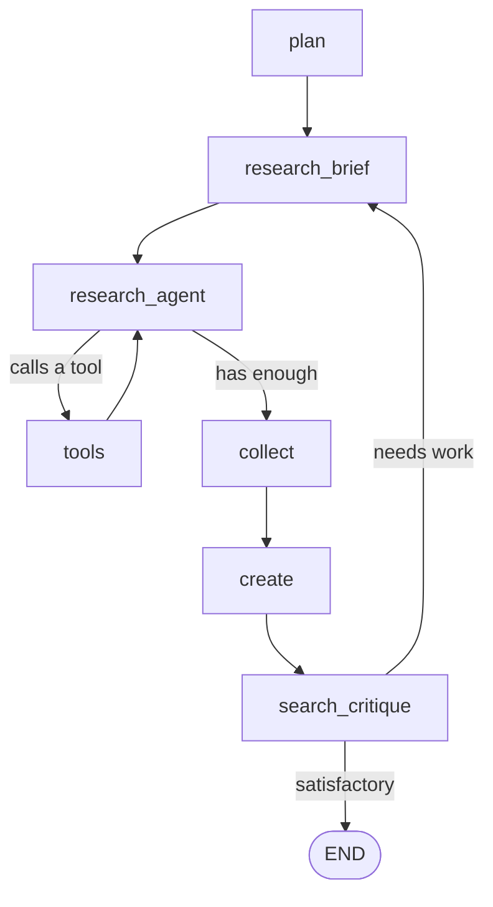

# News Research Agent

A command-line research agent that takes a news topic and a time period, plans its own
search queries, gathers real-time articles with [Tavily](https://tavily.com), and writes an
executive summary — critiquing its own output and retrying when the result isn't good enough.

Built with [LangGraph](https://langchain-ai.github.io/langgraph/) for the control flow and
[OpenRouter](https://openrouter.ai) for model access, so you can run it against any model
OpenRouter exposes (OpenAI, Anthropic, Google, Llama, …) by changing one environment variable.

---

## How it works

There are two modes, both built as LangGraph state machines.

### Agent mode (default)

A research agent gathers the news. It has two tools and decides for itself which to call, with
what inputs, and when it has enough:



| Node | What it does |
| --- | --- |
| `plan` | Same as the baseline below. |
| `research_brief` | Gives the agent its task (topic, time period, today's date). On a retry it passes the critique feedback instead. |
| `research_agent` | The model chooses the next action: `search_news(query, start_date, end_date)`, a Tavily news search limited to that date range, or `read_article(url)` for an article's full text. It can also decide to stop. It gets up to **6 tool turns** per round, then must stop. |
| `tools` | Runs the tool calls the agent asked for and returns the results to it. |
| `collect` | Gathers every tool result (minus empty or failed ones) for `create`. |
| `create`, `search_critique` | Same as the baseline below. When the critique fails, the feedback goes back to the agent, which can research further. |

Agent mode needs a model that supports tool calling (see Troubleshooting).

### Baseline mode (`--baseline`)

The original fixed workflow: five nodes, one feedback loop, and the model never chooses an action.


| Node | What it does |
| --- | --- |
| `plan` | Prompts for the topic and time period. Each answer goes through an LLM evaluator that fixes typos, rejects gibberish or vague input, and re-asks until both are valid. Future dates are rejected. |
| `research_plan` | Generates 3 diverse search queries, converting relative time expressions ("last week") into absolute `YYYY-MM-DD` dates. On a retry it folds the critique feedback into the prompt. |
| `generate` | Runs every query through Tavily (3 results each) and concatenates the source URLs and content. |
| `create` | Synthesizes the collected results into an executive summary. |
| `search_critique` | A senior-editor evaluator judges the summary for comprehensiveness, neutrality, and relevance. If it fails, control loops back to `research_plan` with feedback — up to **2 retries**, after which the best effort is accepted. |

State is carried in a `TypedDict` (`AgentState` in [agent.py](agent.py)) holding the topic,
time period, queries, raw results, summary, critique feedback, and loop counter.

### Structured output that works on any model

Many OpenRouter models have no tool-calling support and quietly ignore `response_format`,
which breaks LangChain's `with_structured_output`. [llm.py](llm.py) wraps this in
`with_schema()`, which:

1. Tries native structured output first.
2. On failure, falls back to embedding the JSON schema in the prompt and extracting the first
   JSON object from the reply (handling code fences and surrounding prose), with two corrective
   retries.
3. Remembers which models lack native support, so later calls skip the doomed first attempt.

---

## Requirements

- Python 3.9+
- An [OpenRouter API key](https://openrouter.ai/keys)
- A [Tavily API key](https://app.tavily.com) (the free tier is enough to try it)

## Setup

```bash
pip install -r requirements.txt
```

Copy the example environment file and fill in your keys:

```bash
cp .env.example .env
```

### Environment variables

| Variable | Required | Default | Purpose |
| --- | --- | --- | --- |
| `OPENROUTER_API_KEY` | ✅ | — | OpenRouter API key. The agent raises a clear error at startup if it's missing. |
| `TAVILY_API_KEY` | ✅ | — | Tavily search key, read automatically by `TavilyClient()`. |
| `OPENROUTER_MODEL` | — | — | The [model slug](https://openrouter.ai/models) to run against, e.g. `anthropic/claude-sonnet-4.5`, `google/gemini-2.5-pro`. |
| `OPENROUTER_MAX_TOKENS` | — | model default | Caps completion length. Useful on free accounts that can't afford a model's default `max_tokens`. |
| `OPENROUTER_SITE_URL` | — | — | Sent as `HTTP-Referer` for OpenRouter's app rankings. |
| `OPENROUTER_APP_NAME` | — | — | Sent as `X-Title` for OpenRouter's app rankings. |

`.env` is gitignored — keep your keys out of version control.

## Usage

### Web app (Briefleaf)

```bash
streamlit run app.py
```

It opens in your browser as **Briefleaf**.

- **Topics screen.** Add a topic, choose a time period (Today, Last week, Last month, or Custom
  dates) and press **Save topic**. The topic checker runs at save time and fixes typos. Each
  saved topic is a card with **Run**, delete, and when it last ran. Relative periods are worked
  out on the day you run them.
- **Watching the agent work.** Each step appears as it happens:
  - the task handed to the agent
  - every search it chooses (query and dates)
  - the articles it finds and any it reads in full
  - "Research complete" when it stops searching
  - the summary and the editor check, including any retry
- **Follow-up chat.** When the report is ready, ask follow-up questions underneath it. The same
  agent answers. It works from the report and sources, and searches again only when it needs
  to. Those steps show live too.
- **Previous chats.** The sidebar lists every run, one line each, with a delete button. Each chat
  keeps its report, follow-ups, and the steps behind every answer. They're stored as JSON in
  `data/` (gitignored).

The logo is in `assets/`, and the green theme is in `.streamlit/config.toml`.

### Command line

```bash
python agent.py
```

To run the original fixed workflow instead (kept as a baseline for comparison):

```bash
python agent.py --baseline
```

Both modes are interactive and ask for what they need. Example from a baseline run:

```
Starting News Research (baseline fixed workflow)...

--- Step: PLAN ---

> Please enter the news topic you are interested in: eu ai regulaton
[*] Auto-corrected topic to: EU AI regulation

> Please enter the time period (e.g., 'last 7 days', 'August 2026'): lst week
[*] Auto-corrected time to: last week

--- Step: RESEARCH PLAN (Query Generation) ---
--- Step: GENERATE (Execution) ---
[*] Searching Tavily for: ['EU AI Act enforcement 2026-08-16..2026-08-23', ...]
--- Step: CREATE (Drafting Report) ---
--- Step: SEARCH CRITIQUE ---
[*] Critique Passed: Report is satisfactory.

========================================
       FINAL RESEARCH REPORT
========================================
...
```

In agent mode, the RESEARCH PLAN and GENERATE steps are replaced by RESEARCH BRIEF and the
agent's tool calls, printed as `[*] Agent calls search_news({...})`.

---

## Project structure

| File | Contents |
| --- | --- |
| [agent.py](agent.py) | State definition, the nodes and tools for both modes, the graphs (baseline, agent, follow-up chat), and the CLI entry point. |
| [app.py](app.py) | Briefleaf, the Streamlit web app: Topics screen, the live step-by-step view of the agent, follow-up chat, previous chats. |
| [assets/](assets) | Briefleaf logo (wordmark and mark as SVG, mark as PNG for the browser tab and chat avatar). |
| [.streamlit/config.toml](.streamlit/config.toml) | Theme: light, with green accents. |
| [storage.py](storage.py) | Saves topics and chats as JSON files in `data/`. |
| [evaluator.py](evaluator.py) | The four LLM evaluators (`evaluate_topic`, `evaluate_time_period`, `evaluate_queries`, `evaluate_critique`), all returning a Pydantic `EvaluationResult` of `is_valid` / `feedback` / `corrected_value`. Runs at `temperature=0`. |
| [llm.py](llm.py) | OpenRouter-backed `ChatOpenAI` factory and the `with_schema` structured-output shim. |
| [.env.example](.env.example) | Template for the environment variables above. |

## Notes and limitations

- **Command line is interactive only.** Topic and time period come from `input()`; the only CLI
  flag is `--baseline`, and the report is printed to stdout rather than saved. The web app saves
  topics and chats.
- **Web app runs one thing at a time.** Clicking elsewhere in the app during a run stops that
  run. It's a local, single-user app with no login.
- **Query validation is advisory (baseline).** If `evaluate_queries` flags a problem, the
  baseline prints a warning and searches anyway. Agent mode has no query check.
- **Agent runs vary.** In agent mode, the number of searches, and so the run time and cost,
  changes from run to run.
- **Retry budget is fixed** at 2 critique loops before the current draft is accepted.
- **Search failures degrade gracefully.** A failed Tavily call is logged and skipped; if every
  query fails, the summary is built from `"No results found."` — which the critique node then
  flags as invalid, triggering a retry.
- **Cost.** A single run makes several LLM calls (input evaluation, query generation, query
  validation, summarization, critique) plus up to two more full loops. Pick a cheap model slug
  and set `OPENROUTER_MAX_TOKENS` if that matters.

## Troubleshooting

| Symptom | Fix |
| --- | --- |
| `OPENROUTER_API_KEY is not set` | Create `.env` from `.env.example` and add your key. |
| `... could not produce JSON matching the schema` | The chosen model is too weak for structured output — switch `OPENROUTER_MODEL` to a stronger one. |
| `Agent mode needs a model that supports tool calling` | Switch `OPENROUTER_MODEL` to a model that lists tool support on OpenRouter, or run with `--baseline`. |
| Empty or truncated reports | Raise or unset `OPENROUTER_MAX_TOKENS`. |
| Tavily errors printed per query | Check `TAVILY_API_KEY` and your remaining free-tier credits. |
