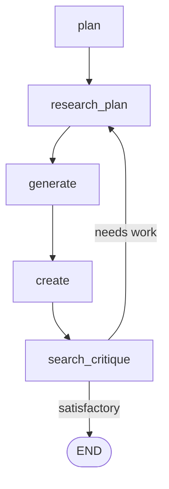

# News Research Agent

A command-line research agent that takes a news topic and a time period, plans its own
search queries, gathers real-time articles with [Tavily](https://tavily.com), and writes an
executive summary — critiquing its own output and retrying when the result isn't good enough.

Built with [LangGraph](https://langchain-ai.github.io/langgraph/) for the control flow and
[OpenRouter](https://openrouter.ai) for model access, so you can run it against any model
OpenRouter exposes (OpenAI, Anthropic, Google, Llama, …) by changing one environment variable.

---

## How it works

The agent is a LangGraph state machine with five nodes and one feedback loop:



| Node | What it does |
| --- | --- |
| `plan` | Prompts for the topic and time period. Each answer goes through an LLM evaluator that fixes typos, rejects gibberish or vague input, and re-asks until both are valid. Future dates are rejected. |
| `research_plan` | Generates 3 diverse search queries, converting relative time expressions ("last week") into absolute `YYYY-MM-DD` dates. On a retry it folds the critique feedback into the prompt. |
| `generate` | Runs every query through Tavily (3 results each) and concatenates the source URLs and content. |
| `create` | Synthesizes the collected results into an executive summary. |
| `search_critique` | A senior-editor evaluator judges the summary for comprehensiveness, neutrality, and relevance. If it fails, control loops back to `research_plan` with feedback — up to **2 retries**, after which the best effort is accepted. |

State is carried in a `TypedDict` (`AgentState` in [agent.py](agent.py)) holding the topic,
time period, queries, raw results, summary, critique feedback, and loop counter.

### Structured output that works on any model

Many OpenRouter models have no tool-calling support and quietly ignore `response_format`,
which breaks LangChain's `with_structured_output`. [llm.py](llm.py) wraps this in
`with_schema()`, which:

1. Tries native structured output first.
2. On failure, falls back to embedding the JSON schema in the prompt and extracting the first
   JSON object from the reply (handling code fences and surrounding prose), with two corrective
   retries.
3. Remembers which models lack native support, so later calls skip the doomed first attempt.

---

## Requirements

- Python 3.10+ (the code uses `str | None` syntax)
- An [OpenRouter API key](https://openrouter.ai/keys)
- A [Tavily API key](https://app.tavily.com) (the free tier is enough to try it)

## Setup

```bash
pip install -r requirements.txt
```

Copy the example environment file and fill in your keys:

```bash
cp .env.example .env
```

### Environment variables

| Variable | Required | Default | Purpose |
| --- | --- | --- | --- |
| `OPENROUTER_API_KEY` | ✅ | — | OpenRouter API key. The agent raises a clear error at startup if it's missing. |
| `TAVILY_API_KEY` | ✅ | — | Tavily search key, read automatically by `TavilyClient()`. |
| `OPENROUTER_MODEL` | — | — | The [model slug](https://openrouter.ai/models) to run against, e.g. `anthropic/claude-sonnet-4.5`, `google/gemini-2.5-pro`. |
| `OPENROUTER_MAX_TOKENS` | — | model default | Caps completion length. Useful on free accounts that can't afford a model's default `max_tokens`. |
| `OPENROUTER_SITE_URL` | — | — | Sent as `HTTP-Referer` for OpenRouter's app rankings. |
| `OPENROUTER_APP_NAME` | — | — | Sent as `X-Title` for OpenRouter's app rankings. |

`.env` is gitignored — keep your keys out of version control.

## Usage

```bash
python agent.py
```

The agent is interactive; it asks for what it needs:

```
Starting News Research Agent (Refactored Flow)...

--- Step: PLAN ---

> Please enter the news topic you are interested in: eu ai regulaton
[*] Auto-corrected topic to: EU AI regulation

> Please enter the time period (e.g., 'last 7 days', 'August 2026'): lst week
[*] Auto-corrected time to: last week

--- Step: RESEARCH PLAN (Query Generation) ---
--- Step: GENERATE (Execution) ---
[*] Searching Tavily for: ['EU AI Act enforcement 2026-08-16..2026-08-23', ...]
--- Step: CREATE (Drafting Report) ---
--- Step: SEARCH CRITIQUE ---
[*] Critique Passed: Report is satisfactory.

========================================
       FINAL RESEARCH REPORT
========================================
...
```

---

## Project structure

| File | Contents |
| --- | --- |
| [agent.py](agent.py) | State definition, the five graph nodes, edges, and the CLI entry point. |
| [evaluator.py](evaluator.py) | The four LLM evaluators (`evaluate_topic`, `evaluate_time_period`, `evaluate_queries`, `evaluate_critique`), all returning a Pydantic `EvaluationResult` of `is_valid` / `feedback` / `corrected_value`. Runs at `temperature=0`. |
| [llm.py](llm.py) | OpenRouter-backed `ChatOpenAI` factory and the `with_schema` structured-output shim. |
| [.env.example](.env.example) | Template for the environment variables above. |

## Notes and limitations

- **Interactive only.** Topic and time period come from `input()`; there are no CLI flags, and
  the report is printed to stdout rather than saved.
- **Query validation is advisory.** If `evaluate_queries` flags a problem, the agent prints a
  warning and searches anyway.
- **Retry budget is fixed** at 2 critique loops before the current draft is accepted.
- **Search failures degrade gracefully.** A failed Tavily call is logged and skipped; if every
  query fails, the summary is built from `"No results found."` — which the critique node then
  flags as invalid, triggering a retry.
- **Cost.** A single run makes several LLM calls (input evaluation, query generation, query
  validation, summarization, critique) plus up to two more full loops. Pick a cheap model slug
  and set `OPENROUTER_MAX_TOKENS` if that matters.

## Troubleshooting

| Symptom | Fix |
| --- | --- |
| `OPENROUTER_API_KEY is not set` | Create `.env` from `.env.example` and add your key. |
| `... could not produce JSON matching the schema` | The chosen model is too weak for structured output — switch `OPENROUTER_MODEL` to a stronger one. |
| Empty or truncated reports | Raise or unset `OPENROUTER_MAX_TOKENS`. |
| Tavily errors printed per query | Check `TAVILY_API_KEY` and your remaining free-tier credits. |
