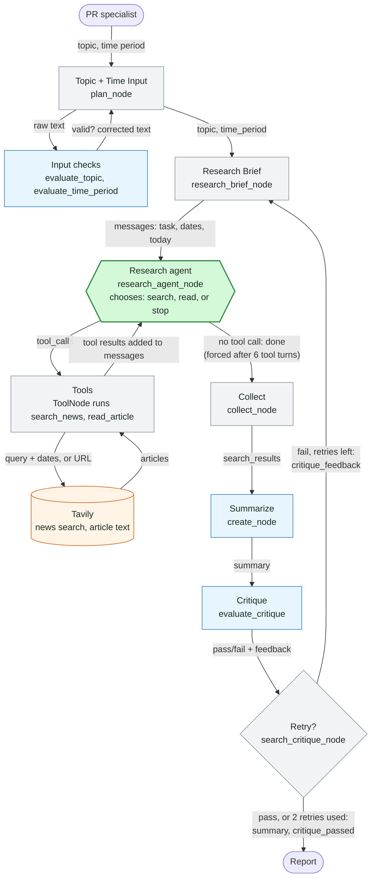
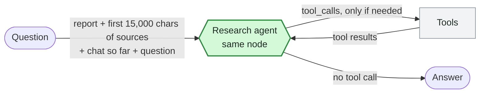

# News Research Agent: Case Study

## Problem

PR specialists need to know what the press has said about a client, a competitor or an issue over a set period, so they can brief the client and decide how to respond. Gathering that by hand means running many searches, checking each story falls inside the right dates, and condensing it all into a neutral summary, which is slow, easy to get wrong, and has to be redone every time the topic or period changes.

## What the system does

It is a single research agent inside a LangGraph workflow (`build_agent_graph` in `agent.py`). In the research step, the model picks which of its two tools to call, with what inputs, and when it has enough. The steps around it (input checks, summary, critique) run in a fixed order. The checks in `evaluator.py` are separate LLM calls, not agents, so this is one agent, not a multi-agent system. All LLM calls go through OpenRouter (`llm.py`), so the model is set by one environment variable.

Step names are in plain English; the code name is in brackets so each step can be traced.

- **Topic Input** (`plan_node` + `evaluate_topic`). Asks for a topic. An LLM fixes typos and rejects topics that are gibberish or too vague. It keeps asking until the topic passes.
- **Time Input** (`plan_node` + `evaluate_time_period`). Asks for a time period. It accepts phrases like "last week" or "past 3 days", fixes typos, and rejects future dates. It keeps asking until the period passes.
- **Research Brief** (`research_brief_node`). Gives the agent the topic, the time period and today's date, and tells it to turn the period into exact start and end dates. On a retry it passes on the critique's feedback instead.
- **Research** (`research_agent_node`, with the tools `search_news` and `read_article` run by a LangGraph `ToolNode`). The model decides each next move. It can search Tavily's news index with a query and a date range of its choosing, read an article's full text (cut to 4,000 characters), or stop. It gets up to 6 tool turns per round. After that it is made to stop (`tool_choice="none"`).
- **Collect** (`collect_node`). Gathers every tool result, leaving out empty or failed ones, and passes them to Summarize. If nothing is left, Summarize receives "No results found."
- **Summarize** (`create_node`). Writes an executive summary of the collected results for the topic.
- **Critique** (`search_critique_node` + `evaluate_critique`, routed by `check_satisfaction_agent`). A "senior editor" check asks whether the summary is comprehensive, neutral and on-topic. If it fails, the feedback goes back to Research Brief, and the agent decides what extra research to do. After 2 retries (3 drafts in total) it accepts the latest draft even if it still failed.
- **Report** (the `__main__` block in `agent.py`). Prints the summary to the terminal. `python agent.py --baseline` runs the original fixed workflow instead (always 3 queries, top 3 results each, no tool choice), kept to compare against the agent.

## How the work is handed off

There is one agent. Every other step is plain code or a one-off LLM call that does a single job and can't choose what happens next. The diagram colours each step by who does the work:

- **Green: the agent.** The model chooses its next action.
- **Blue: a single LLM call.** A fixed prompt in, one answer out.
- **Grey: plain Python.**
- **Orange: an outside service.**

**What carries the handoffs.** Steps never call each other. They all read and write one shared LangGraph state object (`AgentState`), and the labels on the arrows are the state fields each step writes. Small routing functions in code read the state to pick the next step:
- `route_research` sends the run to Tools if the agent asked for a tool, otherwise to Collect.
- `check_satisfaction_agent` sends it back to Research Brief or ends it.

| Step | Done by | Reads | Hands off |
| --- | --- | --- | --- |
| Topic + Time Input | Code, with two LLM checks | what the specialist typed | `topic`, `time_period` |
| Research Brief | Code | `topic`, `time_period`; on a retry, `critique_feedback` | `messages` (the agent's instructions), `tool_rounds` reset to 0 |
| Research agent | **The agent** | `messages` (everything it has seen so far) | `messages` + a decision: which tool, with what inputs, or stop |
| Tools | Code, calling Tavily | the agent's tool calls | tool results, added to `messages` |
| Collect | Code | every tool result in `messages` | `search_results` (empty and failed lookups dropped) |
| Summarize | One LLM call | `topic`, `search_results` | `summary` |
| Critique | One LLM call, then code | `topic`, `summary`, `loop_count` | `is_satisfactory`, `critique_passed`, `critique_feedback`, `loop_count` |

**Two loops, two different deciders.**
- **Agent ⇄ Tools:** the model decides how many times to go round. Code caps it at 6 tool turns per round, then calls the model with `tool_choice="none"` so it has to stop.
- **Critique → Research Brief:** code decides, from the critique's pass/fail and the retry count (at most 2 retries). The agent never sees the draft summary, only the editor's feedback, and it chooses what extra research would fix it.

**In the web app,** input works differently:
- The topic is checked once, when it's saved, by `evaluate_topic`.
- The dates come from the dropdown and are worked out by code, so `evaluate_time_period` isn't used.
- The graph starts at Research Brief (`build_agent_graph(interactive=False)`).

**Follow-up questions** reuse the same agent node and tools in a smaller graph (`build_followup_graph`):

## Open questions

1. **Has it run end to end?** The agent was tested with a fake model and a fake Tavily, not with real ones. A real run is needed before any results go in this case study.
2. **The model picks the dates, and nothing checks them afterwards.** `search_news` passes the agent's start and end dates to Tavily, so the date window is now enforced at search time. But the agent could pick the wrong dates, and Summarize and Critique never see the time period. How often stories fall outside the window is [X]. Should this be described as a known limitation?
3. **A failed draft can still become the final report.** When retries run out, the last draft is printed with no flag in the report itself. The only sign is a console line printed during the run. Should the case study call this out?
4. **Sources may not appear in the summary.** URLs are passed to Summarize, but its prompt doesn't ask for citations, so whether the report cites sources depends on the model. A PR specialist would usually need to show where coverage appeared. Should we claim the output is sourced?
5. **Which model should the results be reported for?** Results will depend on the OpenRouter model. A free model is cheaper to test but rate-limited, and may log prompts; a paid one is closer to what a PR team would actually use.
6. **The step names are no longer in the README.** The plain-English names above came from the README's old Flow section, and the current README uses the code names. Keep these names, or match the README?
7. **Numbers to measure later.** Nothing has been measured yet, including:
   - pass rate, agent vs baseline: [X]% vs [X]%
   - how often the critique fails: [X]%
   - average drafts per run: [X]
   - tool calls per run: [X]
   - time per run: [X] s
